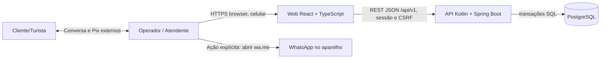
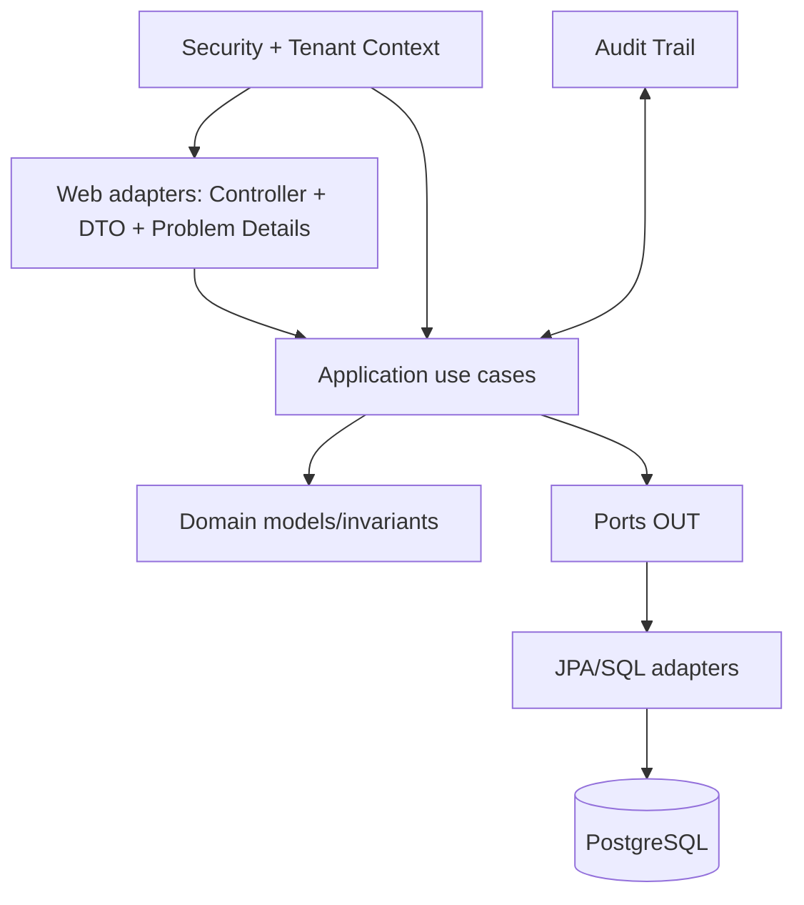
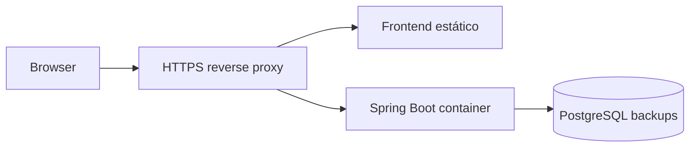

# Arquitetura lógica — contexto e módulos

## Contexto

## Dentro da API

## Contextos e responsabilidades
- **Identity** — autenticação, sessão, papéis, membership e provisioning.
- **Catalog** — `Boat`, `Activity`, inativação; fornece snapshots para saídas.
- **Departures** — criação/edição/fechamento de saída, capacidade e data; centraliza lock de disponibilidade.
- **Bookings** — registrar, listar, confirmar, cancelar, expirar, revalidar vagas.
- **Customers** — dados mínimos de contato, normalização telefone, buscas no tenant.
- **Payments** — ledger manual e consulta de saldo; nunca executa movimentação bancária.
- **Reporting** — contagens derivadas e dashboard (sem cache com fonte de verdade na primeira versão).

## Stack e contratos
- Kotlin JDK21, Spring Boot 4.1.x/Gradle, Spring MVC, Security, Session JDBC, JPA, Flyway; transações explícitas nos application services.
- UI React + TS strict; TanStack Query sincroniza respostas; `apps/web/src/shared/api` centraliza fetch, CSRF, erros e client types OpenAPI.
- Compatibilidade UI/API garantida por contrato OpenAPI, não por duplicação de modelos escritos manualmente em ambos os lados.
- PostgreSQL com uso de `SELECT FOR UPDATE` para concorrência; índices em `(operator_id, departure_id, status)`, `(operator_id, hold_expires_at)`.

## Cross-cutting
- Problem Details (`type`, `title`, `status`, `detail`, `instance`, `code`, `correlationId`). Para validações, `fieldErrors` não incluir valores sensíveis.
- Observabilidade: request ID, métricas latência HTTP, erros e duração de transações. Nunca incluir nome/telefone em tags.
- Autorização por tenant e role. Erros 404 neutros para recursos de outro operador.
- Regras de negócio e controle de concorrência estão na API, não na UI.

## Deploy de piloto

Sem CI/CD ou provedores definidos; a spec de bootstrap deve criar Dockerfile, compose local, GH Actions/alternativa e pipeline de testes. Não implementar serviços AWS sem justificativa de preço. Garantir domínio único `/` e `/api/v1/` para sessão + CSRF.

## Limites não funcionais (metas iniciais a validar)
- API p95 <= 500 ms em consultas usuais com até 100 saídas e 10 mil reservas/tenant em ambiente piloto medido.
- Nenhum overbooking e nenhum leak entre tenants (restrições duras, independentemente de performance).
- 99% das tarefas essenciais operáveis em viewport 390px e com teclado desktop; objetivo WCAG 2.2 AA.
- RPO <=24h e RTO <=24h durante piloto, condicionado a backup **testado**; nunca prometer disponibilidade/SLA sem infraestrutura operante.
- Adicionar índices e medir explain analyze antes de otimizar prematuramente.
