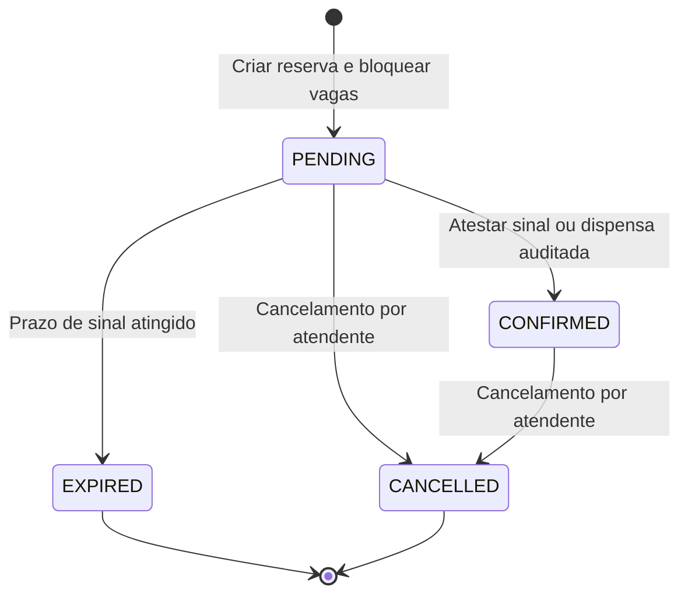

# Modelo de domínio — linguagem ubíqua e estados

## Vocabulário
| Termo | Significado | Campos centrais |
|---|---|---|
| Operator | Empresa assinante / tenant | id, name, status, holdHours, timezone |
| User | Pessoa que acessa o painel | id, email, hash, status |
| Membership | Permissão de acesso a operador | operatorId, userId, role |
| Boat | Embarcação cadastrada pelo operador | id, operatorId, name, capacity, active |
| Activity | Categoria de serviço (pescaria compartilhada) | id, operatorId, title, description, active |
| Departure | Saída agendada, unidade de inventário | id, operatorId, boatId, activityId, startAtUtc, timezone, capacitySnapshot, pricePerSeatCents, depositPerSeatCents, status |
| Customer | Contato responsável pela reserva | id, operatorId, fullName, phoneE164 |
| Booking | Alocação de vagas em uma saída | id, operatorId, departureId, customerId, seats, totalCents, requiredDepositCents, status, holdExpiresAt |
| PaymentEntry | Recebimento ou ajuste auditável | id, operatorId, bookingId, kind, amountCents, method, recordedAt, recordedBy, idempotencyKey |
| AuditEvent | Evento de alteração relevante | operatorId, actorId, entity, entityId, action, changesSummary, at |

**IDs:** UUID gerados no servidor. `createdAt`/`updatedAt` e `operatorId` em todas as entidades de tenant. Referências cruzadas devem ser validadas na aplicação e, sempre que viável, por constraints/índices compostos no banco.

## Status de saída
`SCHEDULED` → `CLOSED` (sem novas reservas); `SCHEDULED` → `CANCELLED`. `CLOSED` significa encerramento manual de novas vendas e não execução do passeio. Atraso/realização do passeio não é rastreado no MVP. Ao cancelar a saída, cancelar também todas as reservas PENDING/CONFIRMED ativas na mesma transação e preservar lançamentos financeiros; sinalizar conciliação manual. Saída cancelada não volta a ativa; criar outra para remarcar. Evitar alteração da data/horário após haver reserva ativa sem fluxo explícito de comunicação.

## Status de reserva

- `PENDING` antes de `holdExpiresAt`: vagas consumidas.
- `PENDING` em/apos `holdExpiresAt`: vagas **não** consumidas, independentemente do job; atualização de status `EXPIRED` lazy/scheduled.
- `CONFIRMED`: vagas consumidas mesmo após deadline original; `EXPIRED/CANCELLED`: nunca consomem.
- Não há `COMPLETED`, `NO_SHOW`, `RESCHEDULED`, `REFUNDED` no MVP.
- **Se expirar após pagamento registrado e antes da confirmação**, o sistema não confirma automaticamente; apresenta pendência operacional para reconciliação. Um OWNER resolve mediante nova reserva, sem prometer reocupação da vaga anterior.

## Cálculo do preço
- Na criação de saída definir `pricePerSeatCents >= 0` e `depositPerSeatCents` entre `0` e `pricePerSeatCents`.
- Na criação de reserva: `totalCents = seats * pricePerSeatCents` e `requiredDepositCents = seats * depositPerSeatCents`; valores ficam congelados na reserva.
- Recebimentos `RECEIPT` (positivos) e ajustes `REVERSAL` (negativos) compõem `netReceivedCents`, entre 0 e `totalCents` (regra MVP; rejeitar ajuste que deixe abaixo de zero).
- Confirmação requer `netReceivedCents >= requiredDepositCents` ou dispensa com motivo. Quando sinal da saída é zero, confirmação manual é livre com auditoria.
- Pagamento a maior que saldo devedor bloqueado. Nenhum estorno bancário é executado, `REVERSAL` é ajuste de sistema que exige evidência/justificativa operacional.

## Cálculo de vagas (BR-002)
```
validPending = status == PENDING && holdExpiresAt > serverNow
active = validPending || status == CONFIRMED
occupied = SUM(booking.seats WHERE departureId=X and active)
available = capacitySnapshot - occupied
```
`available >= 0` é invariante verificável com banco real; o mesmo lock da `Departure` deve ser usado por todas as operações que alterem alocações.

## Regras de interface
- A tela de criação exibe disponibilidade consultada, nunca promete vaga até receber HTTP 201.
- A ação de reserva é protegida contra duplo clique e usa idempotency key estável por tentativa.
- Em 409 `CAPACITY_CONFLICT`, a UI atualiza vagas e oferece ajuste da quantidade (sem refazer cadastro do cliente).
- Em 409 `BOOKING_HOLD_EXPIRED`, explica que a vaga foi liberada e oferece consulta atualizada.
- Em 403/404 para recurso de outro operador, UI não revela existência, navega a erro neutro.
- Em 422 validação, associar mensagens aos campos e preservar dados digitados.
- Expiração de hold é exibida em data/hora local; backend é a fonte da verdade.

## Invariantes por cenário (automatizar)
1. Duas requisições para última vaga: exatamente uma sucesso, outra 409.
2. Dez requisições simultâneas para saída com capacidade 2: total confirmado/pendente válido <=2.
3. Mesmo Idempotency-Key e payload retorna mesmo booking; payload distinto com mesma chave: 409.
4. Expirar libera quantidade exata, inclusive com job parado.
5. Tentativa de reduzir capacidade abaixo da ocupada falha sem mudanças parciais.
6. Cancelar reserva libera vagas; cancelar saída não deixa novas reservas entrarem.
7. Cliente de tenant A não aparece no painel/endpoint tenant B; operações por UUID de outro operador não vazam dados.
8. Somatório pagamentos corrigidos + confirmados nunca supera total; confirmador tem papel válido.
9. `pricePerSeat` alterado no catálogo não muda valor de booking histórico.
10. Todos os horários persistidos como instantes; exibição coerente com timezone.
11. Início da saída passou: novas reservas são recusadas mesmo se status ainda SCHEDULED.
12. Cancelar saída cancela reservas ativas atomicamente, preservando recebimentos e pendências de reembolso externo.

## Hipóteses de produto pendentes de piloto
H-01 12 h de hold; H-02 sinal fixo por passageiro; H-03 um cliente titular por reserva; H-04 operador pode fazer reservas para múltiplos passageiros com 1 telefone; H-05 capacidade de barco não pode ser ultrapassada em saída; H-06 ausência de remarcação na primeira versão. Para alterar uma hipótese adotada, atualizar requisitos + ADR se alterar arquitetura.
